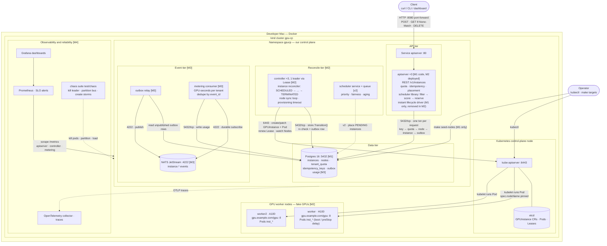
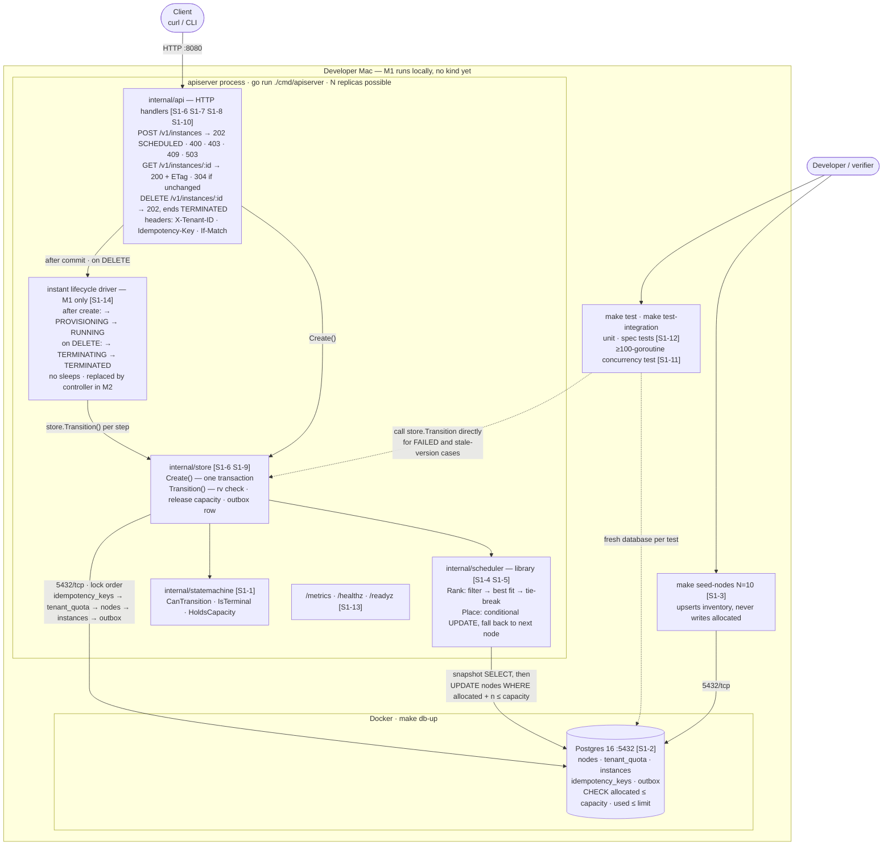
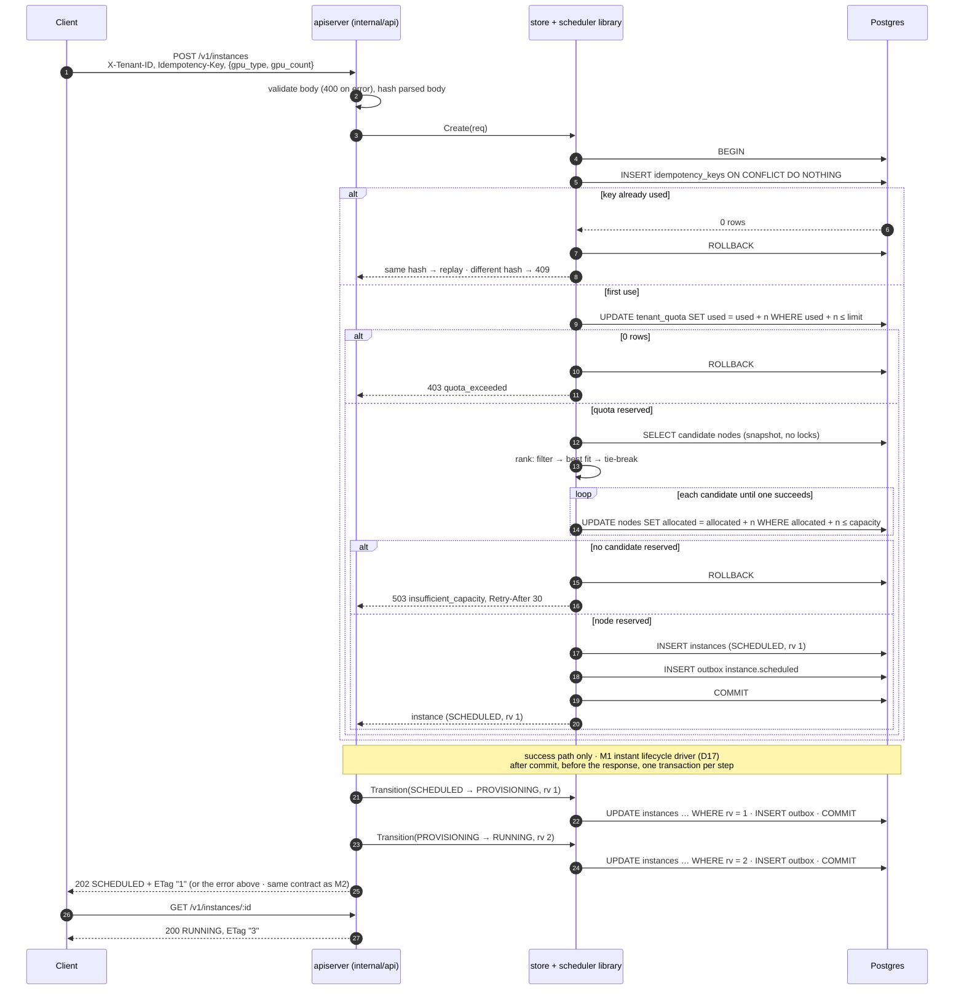
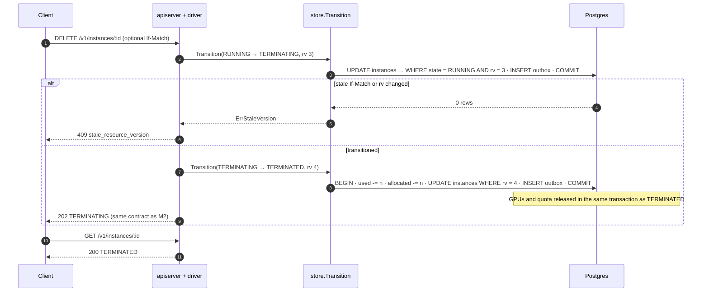
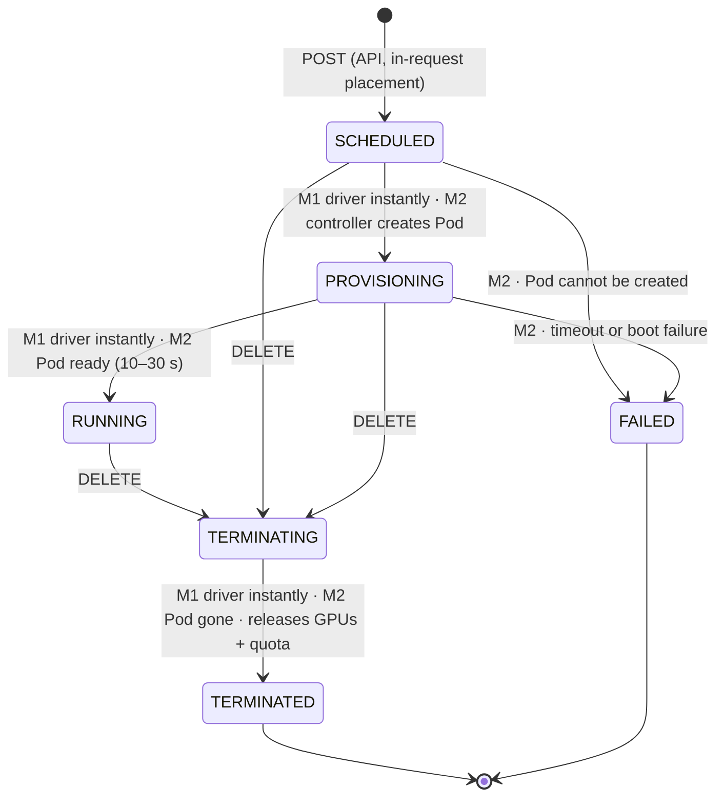
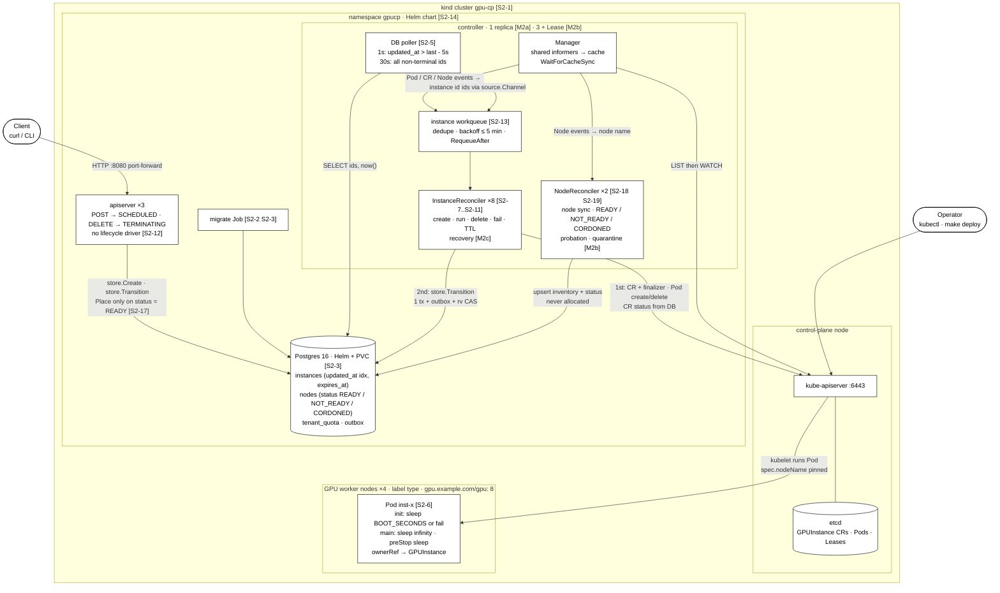
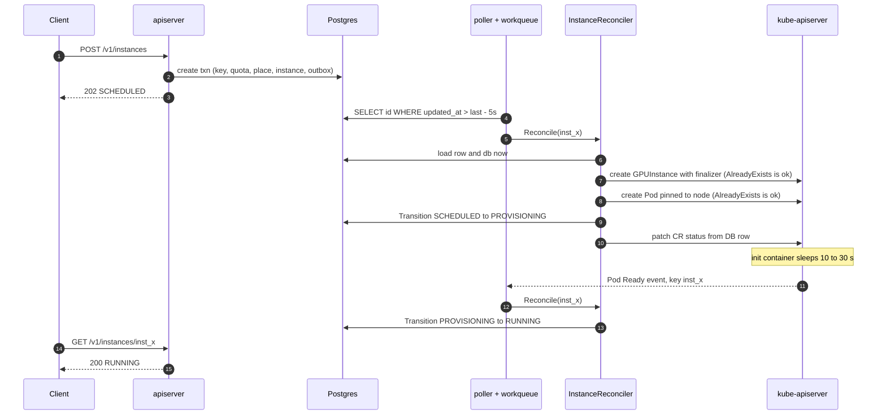
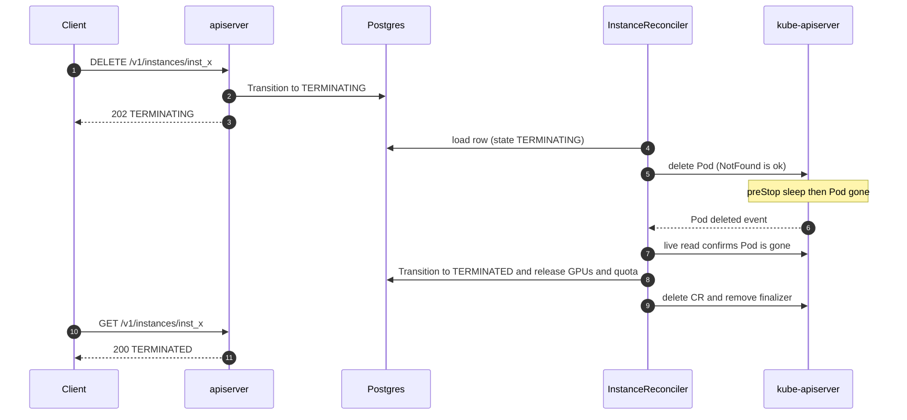

# Architecture diagrams

Two views:
1. **Full system (M1–M4)** — everything we plan to build, each box tagged
   with the milestone that delivers it.
2. **Milestone 1 only** — what exists after M1, tagged with the stories that
   build each box.
3. **Milestone 2 (controller)** — black-and-white view of M2a, with M2b/M2c
   parts tagged.

Notation: solid arrows are calls/data flow, labelled with port and protocol.
Dashed arrows are future (v2) or test-only paths. Cylinders are data stores.
Tags: `[M1]`…`[M4]` milestone, `[v2]` deferred, `[S1-n]` story.

---

## 1. Full system design (M1–M4)



### What each milestone adds

| Milestone | Adds to the picture |
|---|---|
| **M1** | apiserver code (HTTP API, scheduler library, state machine, store) + Postgres schema. Runs locally, not yet in kind. |
| **M2** | kind deployment, GPUInstance CRD, controller ×3 with leader election, node sync, Pods with boot/shutdown delays, provisioning timeout, injected boot failures, drift reconciler |
| **M3** | outbox relay, NATS JetStream, metering consumer, usage table; optional push notifications built from these events |
| **M4** | Prometheus, Grafana, OpenTelemetry, SLOs and alerts, chaos suite, postmortems |
| **v2** | queue (PENDING), separate leader-elected scheduler service, priority/fairness/aging, aligned GPU indices |

---

## 2. Milestone 1 only

In M1 everything runs **on the laptop without kind**: the apiserver as a
local process, Postgres in one Docker container. There is no controller, so
an **instant lifecycle driver** inside the apiserver walks the legal states
right away (D17): after create SCHEDULED → PROVISIONING → RUNNING, and on
DELETE → TERMINATING → TERMINATED, which releases GPUs and quota. Every step
goes through `store.Transition`, the same function the M2 controller will
call, so the state machine and outbox history are identical in M1 and M2.



### Create request in M1, step by step



### Delete request in M1



### Instance states: M1 vs M2

Same state machine in both milestones; only *who* drives it and *how fast* changes.



PENDING is not shown: it is used only by the v2 queue.

### In M1 vs not in M1

| In M1 | Not in M1 (milestone) |
|---|---|
| HTTP API: create, get (ETag / 304), delete | Controller, CRD, Pods, kind deployment (M2) |
| Scheduler library inside the apiserver | Leader election, node sync loop (M2) |
| State machine rules + `store.Transition` | Provisioning timeout, boot failures (M2) |
| Instant lifecycle driver (removed in M2) | |
| Postgres schema with CHECK constraints | Outbox relay, NATS, metering (M3) |
| Quota, idempotency, fail-fast 503 | Push notifications (M3+) |
| Outbox rows written (not yet published) | Prometheus/Grafana/OTel stack, chaos (M4) |
| Seed script for nodes | Queue and scheduler service (v2) |
| Unit, integration and concurrency tests | |
| `/metrics`, `/healthz`, `/readyz` endpoints | |

---

## 3. Milestone 2 (controller)

Design: `docs/adr/0002-milestone-2-controller.md` (Proposed); reasoning:
`docs/Discussion.md` D19–D36. Everything now runs **inside kind**. The API
only creates (→ SCHEDULED) and requests deletion (→ TERMINATING); the
controller does every other transition. Kubernetes objects are changed
first, then the DB (D21). Tags: `[M2a]`, `[M2b]`, `[M2c]`, `[S2-n]`.



### Create to RUNNING in M2



### Delete in M2



### Instance states in M2

```mermaid
stateDiagram-v2
    classDef default fill:#ffffff,stroke:#000000,color:#000000
    [*] --> SCHEDULED: API create
    SCHEDULED --> PROVISIONING: controller, Pod created
    PROVISIONING --> RUNNING: controller, Pod Ready
    SCHEDULED --> TERMINATING: API DELETE or TTL
    PROVISIONING --> TERMINATING: API DELETE or TTL
    RUNNING --> TERMINATING: API DELETE or TTL
    TERMINATING --> TERMINATED: controller, Pod gone, release
    SCHEDULED --> FAILED: controller
    PROVISIONING --> FAILED: boot_failed or provisioning_timeout
    RUNNING --> FAILED: pod_lost (new in M2a)
    TERMINATED --> [*]
    FAILED --> [*]
```

M2c adds RECOVERING (RUNNING → RECOVERING → PROVISIONING, or → FAILED
`no_capacity`); not shown until it is designed in stories.
